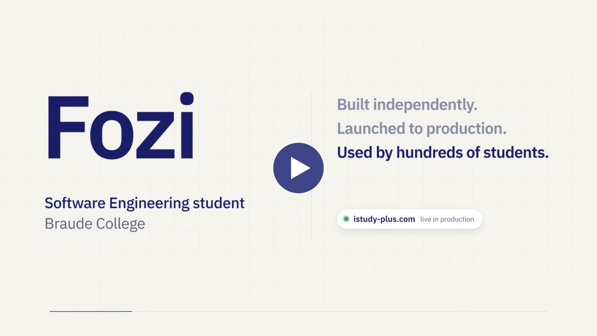
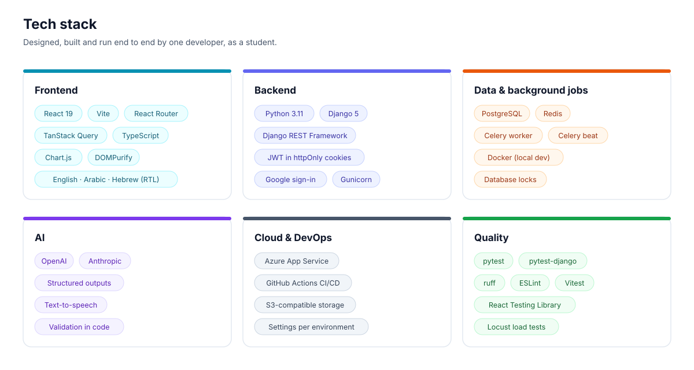
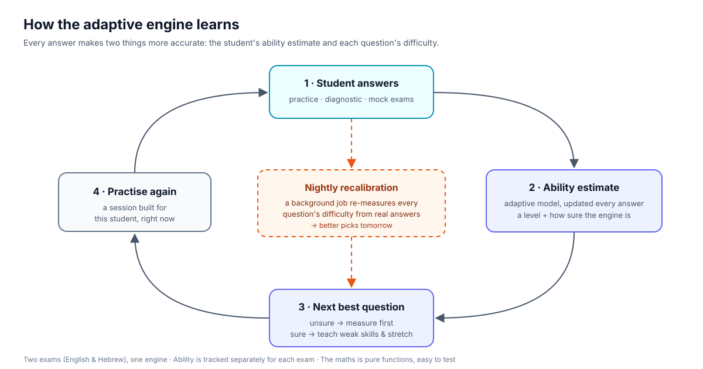
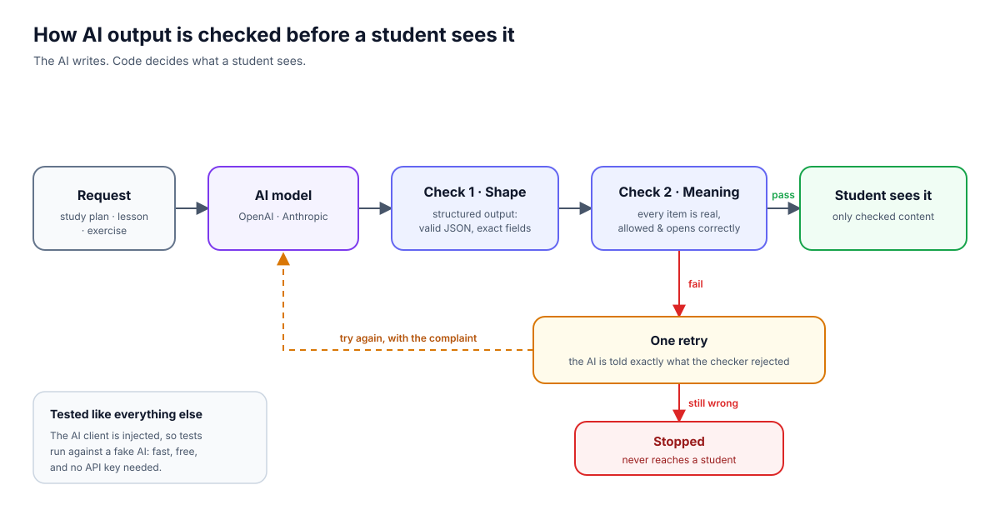
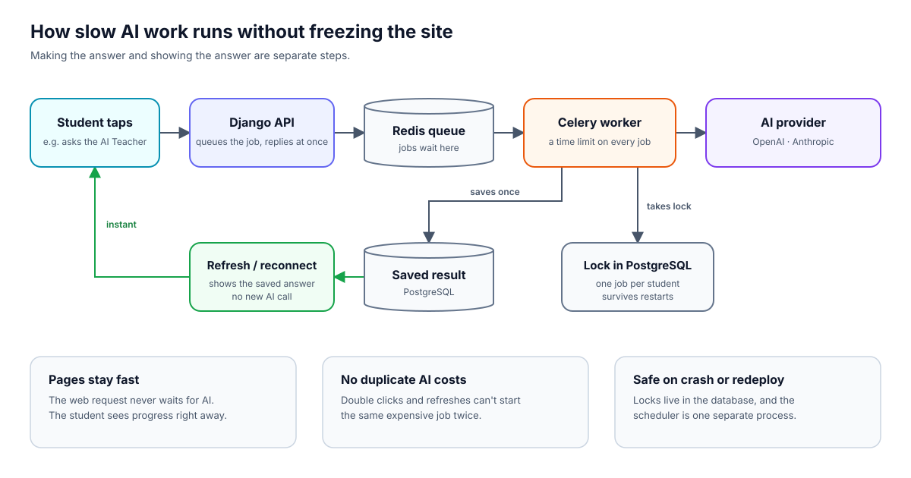

# iStudy+

### 🎬 1-minute intro video

*Click the image to watch the video.*

**Live site:** [istudy-plus.com](https://istudy-plus.com)

---

## What it is

**iStudy+** is an adaptive exam-prep platform for **Amirnet** (English) and **Yaelnet** (Hebrew),
the language exams students in Israel take to get into and move forward in university.

Each student starts with a short diagnostic test. The system estimates their level, and from then on
it picks every practice question, lesson and vocabulary card to help *that* student most.
The aim is to never waste a student's time on a question that teaches them nothing.

The platform works in **English, Arabic and Hebrew**, including right-to-left layouts, because many
learners prepare for an exam that is not in their first language.

> This repository is a **showcase only**. The product's source code, content and data are private.
> These pages explain what I built and how it works at a high level.

## My role

I'm a **student**, and I built iStudy+ **during my studies** as its **sole founder and developer**.
I did all of it myself: product design, backend, both frontends, the adaptive engine, the AI
features, infrastructure, CI/CD, testing, and running it in production.

## Tech stack

| Area | Tools |
|---|---|
| **Backend** | Python 3.11, Django 5, Django REST Framework |
| **Database** | PostgreSQL in every environment, with local dev on Docker |
| **Background jobs** | Celery + Redis, with a separate worker and scheduler |
| **Student app** | React 19, Vite, React Router, TanStack Query, Chart.js |
| **Staff app** | React 19, TypeScript, Vitest + React Testing Library (separate app and deploy) |
| **AI** | OpenAI and Anthropic (Claude) models, plus neural text-to-speech for audio |
| **Auth** | JWT in httpOnly cookies, Google sign-in |
| **Cloud** | Azure App Service, S3-compatible object storage |
| **Quality** | pytest + pytest-django, ruff, ESLint, GitHub Actions CI on every pull request, Locust load testing |
| **i18n** | English, Arabic, Hebrew (RTL) |

## Main features

**For students**
- **Diagnostic test**: estimates the student's starting level and shows their goal and their
  strong and weak skills.
- **Adaptive practice**: every session is built for the student from their current measured
  ability, not from a fixed syllabus.
- **Personal study plan**: an ordered list of "what to do next", built by AI from the student's
  progress and checked by code before the student sees it.
- **Interactive lessons**: step-by-step lesson cards with voice narration and worked examples that
  solve a question one step at a time.
- **AI Teacher**: a chat tutor that gives hints and explanations about the student's own work.
- **Vocabulary trainer**: word lists by level with spaced-repetition review.
- **Mock exams and listening practice**: full exam-style practice, with generated audio for the
  listening sections.
- **Phone-first**: built to be used on a phone, at any hour.

**Behind the scenes**
- **Staff tools**: a separate app for writing and reviewing content.
- **AI content tools**: generate exercises and lessons, with automatic checks before anything
  reaches a student.
- **Own monitoring**: a self-built error tracker and product-health dashboards, with personal data
  removed before anything is saved.

## How it works

| The adaptive engine | AI output checks | Background AI jobs |
|---|---|---|
|  |  |  |

## Learn more

- [Architecture](docs/architecture.md): how the system fits together
- [Hard problems](docs/hard-problems.md): the hardest problems I solved, and how
- [Media plan](docs/media-plan.md): how the screenshots, GIFs and demo video for this page are made

---

*The source code is private. I'm happy to walk through the code in an interview.*
