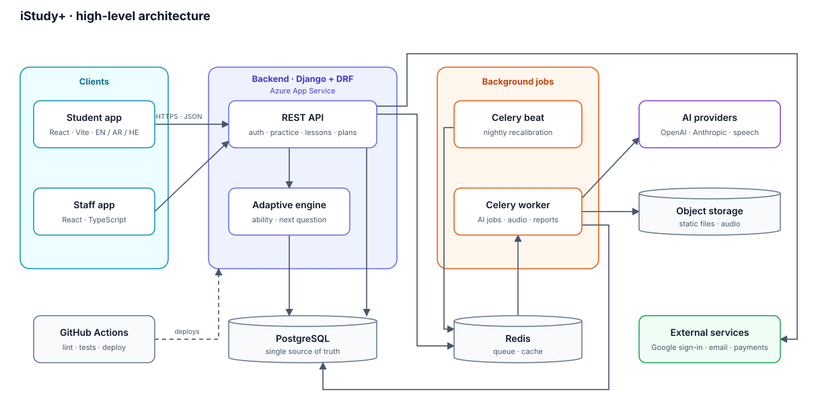
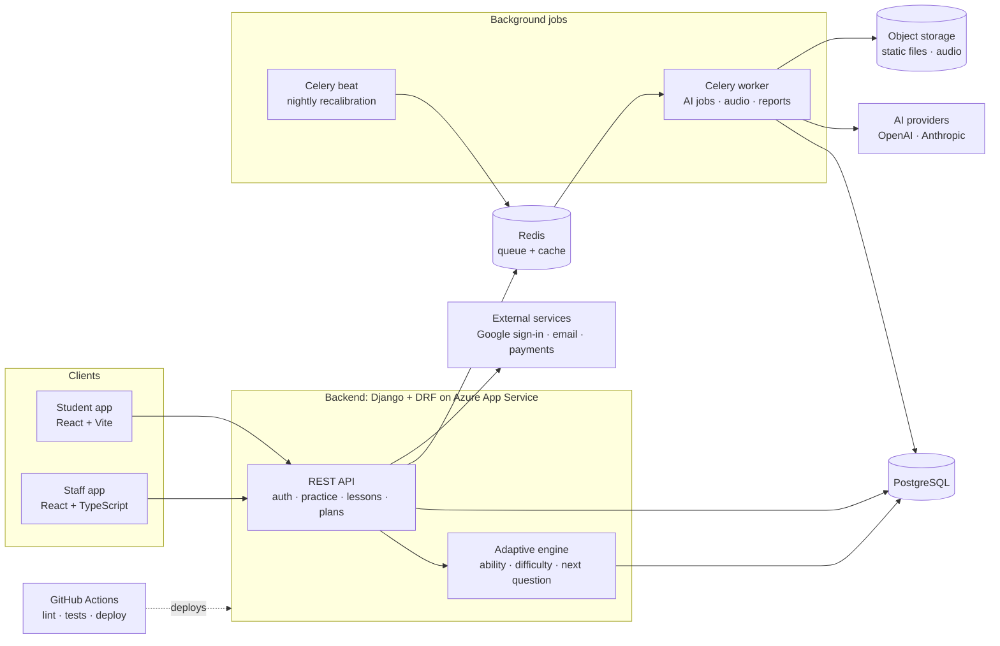

# Architecture

A high-level view of how iStudy+ fits together. Internal details are left out on purpose.

## The main parts

| Part | What it does |
|---|---|
| **Student app** | The single-page app students use: diagnostic, practice, lessons, study plan, AI Teacher, vocabulary. Works in English, Arabic and Hebrew (RTL). |
| **Staff app** | A separate app with its own deploy, for writing and reviewing content. A staff release can never break the student app. |
| **REST API** | One Django backend with JSON APIs for both apps. Login uses JWT in httpOnly cookies. |
| **Adaptive engine** | Estimates each student's ability and each question's difficulty from real answers, and picks what to practise next. |
| **PostgreSQL** | The single source of truth. It runs in every environment, local dev included, so tests mean something about production. |
| **Redis + Celery** | Slow work runs in the background: AI generation, audio and reports. The scheduler runs as its own single process, so nightly jobs never run twice. |
| **AI providers** | OpenAI and Anthropic models generate content, study plans and tutor replies. Code checks everything they return. |
| **Object storage** | Static files and system-generated audio. Users never upload files. |
| **GitHub Actions** | Lint and the full test suite run on every pull request, on a real Postgres and Redis, before deploy. |

## Design principles

- **One engine, two exams.** The exam type is part of the data model, so adding content for an exam
  never means changing the engine.
- **Every difference between environments is a setting.** Dev, testing and production run the same
  code. Secrets come only from environment variables.
- **Slow work never blocks a page.** Anything that calls AI runs in the background with a time limit.
- **Trust code, not the model.** AI output must pass checks in code before a student sees it.
