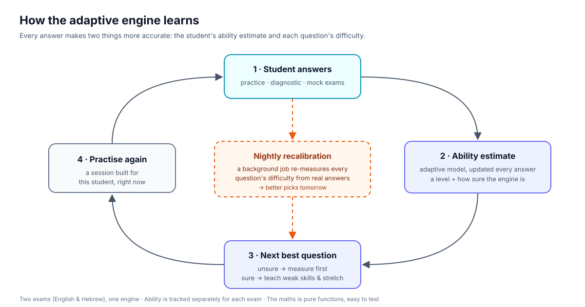
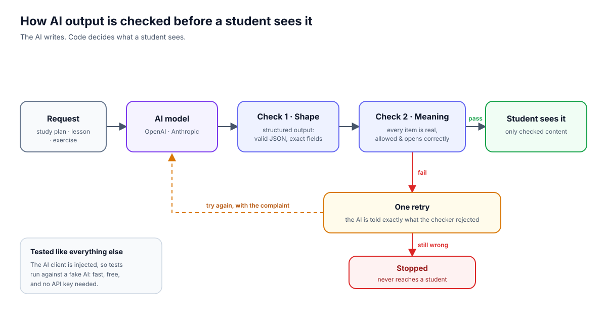
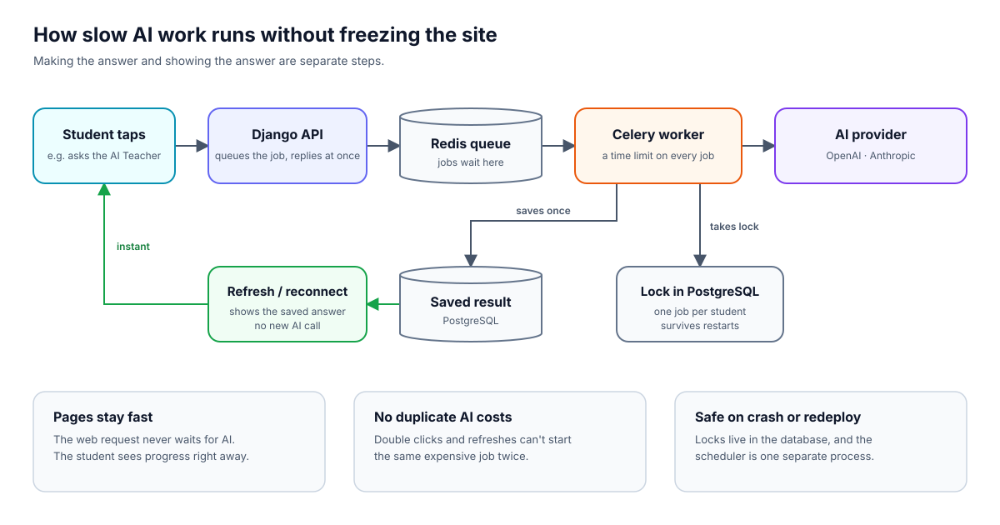

# Hard problems I solved

Five short stories from building iStudy+. Each one explains the **idea**. The code itself stays private.

---

## 1. An adaptive engine that works from a student's first session

**Problem.** The product promises that every question is the most useful one *for this student*.
To keep that promise, the system needs two things it doesn't have on day one: a reliable estimate
of the student's ability, and a reliable difficulty for every question. A new student and a new
question both start with almost no data.

**What I did.**
- I built an **adaptive scoring model** that turns a student's answers into an ability estimate
  *and* a measure of how sure the engine is about it.
- A **nightly background job recalibrates** each question's difficulty from real student answers,
  so the question bank gets more accurate as more students use it.
- Practice sessions change **based on how sure the engine is**, not on how many sessions a student
  has done. While the estimate is still rough, sessions mostly measure. Once it settles, they focus
  on teaching the weakest skills and stretching the student a little above their level.
- Every score in the product reads student answers through **one shared filter**. Once, separate
  queries had quietly started counting lesson answers as real practice. A single shared filter
  makes that kind of mistake impossible.

**Result.** Students get useful sessions from day one, and the engine gets more accurate as the
product grows. The maths is kept as plain, pure functions, so it is easy to test on its own.

---

## 2. Making AI output safe to show students

**Problem.** iStudy+ uses AI (OpenAI and Anthropic models) to write study plans, lessons and
practice content. AI can return broken JSON, make up things that don't exist, or link to a lesson
the student can't open. A student should never see any of that.

**What I did.**
- **Two layers of protection.** First, *structured outputs* force the reply into an exact JSON
  shape, so a retry is never wasted on a missing bracket. Second, **code checks the meaning** of
  the reply: every item the AI mentions must really exist, be available to this student, and
  open correctly.
- **One smart retry.** If the check fails, the AI gets one more try, and the checker's complaint is
  included, so the second attempt knows exactly what to fix.
- **The AI client is injected.** The whole test suite runs against a fake AI, so tests are fast,
  free, and never need a real API key.

**Result.** The AI writes the content, but code decides what a student sees. Bad output gets
fixed or stopped before it reaches a student, and the AI features have the same automated tests
as the rest of the product.

---

## 3. Slow AI jobs that never freeze the site

**Problem.** An AI reply can take many seconds. If that work ran inside a web request, pages would
hang. A student who refreshed or double-clicked could also start the same expensive job twice.

**What I did.**
- All AI work runs in **Celery background workers** with Redis as the queue. Each job has a **time
  limit**, so a stuck AI call can't block a worker forever.
- **Making the result and showing the result are kept separate.** The answer is saved once. After
  that, refreshing the page or reconnecting just shows the saved answer again and never calls the
  AI a second time.
- A **database-backed lock** makes sure only one job runs per student at a time. It works across
  many server processes and survives a restart, which a simple in-memory flag can't do.
- The scheduler runs as its **own single process**, separate from the workers. Adding more workers
  can never make a nightly job run twice.

**Result.** Pages stay fast while AI works in the background, duplicate jobs (and duplicate AI
costs) are prevented, and a crash or redeploy doesn't lose or repeat work.

---

## 4. An error tracker that protects student privacy

**Problem.** I needed to see crashes and errors in production. But error reports often capture
whatever is on screen or in memory, and that can include passwords, emails or phone numbers. I
didn't want student data sent to an outside service or stored where it shouldn't be.

**What I did.**
- I built a **small error tracker of my own** into the backend. It records crashes, failed
  requests, background-job errors and frontend errors, and shows them on a private dashboard.
- **Every value is cleaned before it is saved.** Fields with sensitive names are hidden, emails
  and phone numbers inside text are replaced, and long values are cut short.
- It **never turns an unknown object into text.** In Django, simply printing an object can run a
  database query or show a student's email, so the tracker skips objects it doesn't recognise.

**Result.** I get the information I need to fix problems fast, without collecting personal data I
don't need.

---

## 5. One engine, two exams, three languages

**Problem.** iStudy+ prepares students for **two different exams**: Amirnet (English) and
Yaelnet (Hebrew). It also serves students in **English, Arabic and Hebrew**. Many are Arabic
speakers preparing for an exam in another language. Building a separate product for each exam
would double the work and the bugs.

**What I did.**
- I made **the exam type a part of the data model from day one**. Questions, words, ability
  estimates and skills all carry it. There is one engine and one ability model, with two sets of
  content.
- Each student's ability is **tracked separately for each exam**, so a student can prepare for one
  exam or both.
- The interface and the explanations work in the student's own language, **including full
  right-to-left layouts** for Arabic and Hebrew.

**Result.** Adding or growing an exam is a content task, not a rewrite. Every improvement to the
engine helps both exams at once.
